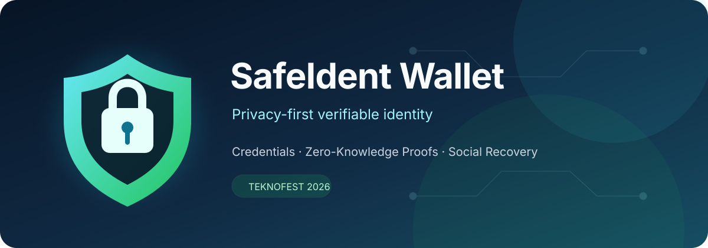
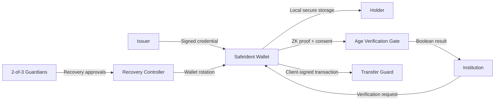

<p align="center">
  
</p>

<p align="center">
  <strong>Mahremiyet odaklı, doğrulanabilir dijital kimlik cüzdanı prototipi</strong>
</p>

<p align="center">
  
  
  
  
  
  
</p>

## Proje özeti

SafeIdent Wallet; kullanıcıların kimlik bilgilerini merkezi bir profilde açığa çıkarmadan taşımasını, doğrulanabilir credential almasını ve gerektiğinde yalnızca gerekli sonucu kanıtlamasını hedefleyen bir TEKNOFEST 2026 Blokzincir Yarışması MVP'sidir.

Prototip; W3C doğrulanabilir credential'ları, devredilemez kimlik bağlarını, zincir üstü durum doğrulamasını, sıfır bilgi kanıtıyla 18+ kontrolünü, risk kontrollü varlık transferini ve 2-of-3 sosyal kurtarmayı tek bir ürün yolculuğunda birleştirir.

> Kaynak kod, yarışma süreci nedeniyle özel depoda tutuluyor. Bu depo; ürün kapsamını, mimariyi, güvenlik sınırlarını ve doğrulanmış mühendislik çıktılarını paylaşan teknik vitrindir.

## Temel yetenekler

| Alan | Uygulanan yaklaşım |
|---|---|
| Kimlik | Wallet possession challenge ve devredilemez kimlik bağı |
| Credential | W3C VCDM 2.0 uyumlu, Ed25519 imzalı `vc+jwt` |
| Mahremiyet | Claim yerine salted commitment ve cihaz tarafında private witness |
| 18+ doğrulama | Groth16 kanıtı; kurum yalnız boolean sonucu görür |
| Varlık transferi | SAFE / WARNING / RISKY preflight ve açık kullanıcı onayı |
| Kurtarma | EIP-712 bağlı, sabit 2-of-3 guardian onayıyla wallet rotation |
| Tutarlılık | Zincir başarılı / veritabanı başarısız durumları için kontrollü reconciliation |
| Denetlenebilirlik | PII içermeyen audit kayıtları ve fail-closed güvenlik davranışı |

## Ürün akışı



## Mimari

```text
┌────────────────────┐      ┌─────────────────────┐
│ Expo Mobile Wallet │◄────►│ Fastify + Prisma API│
└─────────┬──────────┘      └──────────┬──────────┘
          │                             │
          │ local signing / ZK proof    │ PostgreSQL
          │                             │
┌─────────▼──────────┐      ┌──────────▼──────────┐
│ Institution Web UI │      │ Solidity Contracts │
└────────────────────┘      └──────────┬──────────┘
                                      │
                           Identity · Registry · Gate
                           Transfer · Recovery
```

Sistem zincir yapılandırması olmadığında `OFFCHAIN_ONLY` profilinde çalışır. Zincir gerektiren mahremiyet ve varlık akışları eksik yapılandırmada sessizce devam etmek yerine fail-closed davranır.

## Güvenlik ve gizlilik tasarımı

- Gerçek kimlik bilgileri veya gerçek kurum entegrasyonu kullanılmaz; demo verileri sentetiktir.
- Raw credential, claim, API key, holder session ve commitment salt veritabanına açık biçimde yazılmaz.
- Zincire yalnız salted commitment ve gerekli işlem referansları gider.
- ZKP private witness kullanıcının cihaz sınırından çıkmaz.
- Transfer ve recovery özel anahtarları API'ye, veritabanına veya loglara gönderilmez.
- Recovery akışı private key ya da seed parçalarını birleştirmez.
- Reconciliation aracı yeni işlem imzalamaz; yalnız mevcut zincir gerçeğini doğrular ve kontrollü biçimde benimser.
- Otomatik testler, statik analiz ve tehdit modeli uygulanır; bağımsız üçüncü taraf güvenlik denetiminin yerini tuttuğu iddia edilmez.

## Teknoloji yığını

| Katman | Teknolojiler |
|---|---|
| Mobil | Expo, React Native, TypeScript, secure storage |
| Web | TypeScript tabanlı kurum paneli |
| API | Node.js, Fastify, Prisma |
| Veri | PostgreSQL |
| Blockchain | Solidity, Foundry, viem, Anvil |
| ZKP | Circom, snarkjs, Groth16 |
| Credential | W3C VCDM 2.0, Ed25519/EdDSA, RFC 8785 |
| Kalite | GitHub Actions, Slither, dependency kontrolleri |

## Doğrulanmış mühendislik çıktıları

- Birleşik yerel ürün yolculuğu: **11/11 senaryo başarılı**
- API, mobil, smart contract ve ZKP için **4 ayrı CI workflow'u**
- Gerçek PostgreSQL migration'ları ve izole Anvil zinciriyle dikey entegrasyon
- Gerçek Groth16 proof üretimi ve Gate doğrulaması
- Credential issue/finalize/revoke yaşam döngüsü
- Zincir başarılıyken DB yazımı başarısız olan işlemler için tekrar çalıştırılabilir reconciliation
- Event argümanı uyuşmazlığında otomatik kabul yerine quarantine

## Kapsam ve sınırlar

Bu çalışma bir yarışma MVP'sidir; production kimlik sağlayıcısı değildir. Gerçek e-Devlet/üniversite entegrasyonu, mainnet deployment, production MPC/custody recovery ve bağımsız güvenlik denetimi kapsam dışındadır. Sepolia dağıtım altyapısı hazırlanmış olmakla birlikte public deployment yapılmamıştır.

## Geliştirici

**Hasan Ersöz** — Bilgisayar Mühendisliği öğrencisi  
[GitHub](https://github.com/hasanersooz26) · [LinkedIn](https://www.linkedin.com/in/hasan-ers%C3%B6z-26203829b)

Güvenlikle ilgili bildirimler için [SECURITY.md](SECURITY.md) dosyasını inceleyin.
